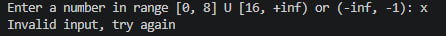
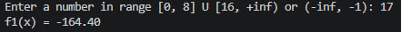
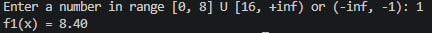
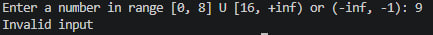
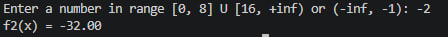
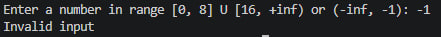

##### Національний технічний університет України
##### «Київський політехнічний інститут імені Ігоря Сікорського»
##### Факультет інформатики та обчислювальної техніки
##### Кафедра обчислювальної техніки
---
# Структури даних та алгоритмів Лабораторна робота №1

---
##### Виконала
Студент групи: ІО-61\
Ходаківська Є. В.\
номер у списку групи: 27

##### Перевірив
Русінов В. В.

###### Київ 2026

---
## Завдання

Задано дійсне число x. Визначити значення заданої за варіантом кусково-неперервної функції y(x), якщо воно існує, або вивести на екран повідомлення про неіснування функції для заданого x.

Розв'язати задачу **двома способами** (написати дві програми):

1. У програмі дозволяється використовувати тільки одиничні операції порівняння (`=`, `<>`, `<`, `<=`, `>`, `>=`) і **не дозволяється** використовувати булеві (логічні) операції (`not`, `and`, `or` тощо);
2. У програмі необхідно **обов'язково** використати булеві (логічні) операції (`not`, `and`, `or` тощо); використання булевих операцій не повинно бути надлишковим.

###### Умови до варіанту 27:
Для заданого дійсного x обчислити:

```
         f1(x) ,  x ∈ D1
y(x) =
         f2(x) ,  x ∈ D2
```

|Варіант|f1(x), x ∈ D1|f2(x), x ∈ D2|
|---|---|---|
|7, 17, 27 | –3x²/5 + 9, x ∈ [0,8] ∪ [16, +∞) | 15x – 2, x ∈ (–∞, –1)|

---
## Блок схеми

\

---

\

---
## Програмний код програм
#### Перший розв'язок

```c
#include <stdio.h>

int main() {
    double x, d_1, d_2;

    while (1) {
        printf("Enter a number in range [0, 8] U [16, +inf) or (-inf, -1): ");
        
        if (scanf("%lf", &x) != 1) {
            printf("Invalid input, try again\n");
            while (getchar() != '\n'); 
            continue;
        }

        if (x >= 16){
            d_1 = (-3.0 * (x * x)) / 5.0 + 9.0;
            printf("f1(x) = %.2lf\n", d_1);
            break;
        } 
        else if (x >= 0) {
            if (x <= 8) {
                d_1 = (-3.0 * (x * x)) / 5.0 + 9.0;
                printf("f1(x) = %.2lf\n", d_1);
                break;
            } else {
                printf("Invalid input\n");
                break;
            }
        } 
        else if (x < -1) {
            d_2 = (15.0 * x) - 2.0;
            printf("f2(x) = %.2lf\n", d_2);
            break;
        } 
        else {
            printf("Invalid input\n");
            break;
        }
    }

    return 0;
}
```
#### Другий розв'язок
```c
#include <stdio.h>

int main(void) {
    double x, y;

    printf("Enter a number in range [0, 8] U [16, +inf) or (-inf, -1): ");
    scanf("%lf", &x);

    if ((x >= 0.0 && x <= 8.0) || (x >= 16.0) || (x < -1.0)) {

        if (x < -1.0) {
            y = 15.0 * x - 2.0;
        } 
        else {
            y = -3.0 * (x * x) / 5.0 + 9.0;
        }
        printf("y(x) = %.2lf\n", y);
        
    } 
    else {
        printf("Error: function is undefined for this value.\n");
    }

    return 0;
}

```

---
## Тести кожної програми
Тестовий набір значень та очікувані результати:

| №   | Тестові значення | Очікуваний результат                   |
| --- | ---------------- | -------------------------------------- |
| 1   | x                | "Invalid input, try again"             |
| 2   | 17               | -164.40                                |
| 3   | 1                | 8.40                                   |
| 4   | 9                | "Invalid input"                        |
| 5   | -2               | -32.00                                 |
| 6   | -1               | "Invalid input"                        |

---
###### Результати тестів:

Перший розв'язок:

\
\
\
\
\
\


Другий розв'язок:
\
\
\


---