##### Національний технічний університет України
##### «Київський політехнічний інститут імені Ігоря Сікорського»
##### Факультет інформатики та обчислювальної техніки
##### Кафедра обчислювальної техніки
---
# Структури даних та алгоритмів Лабораторна робота №1

---
##### Виконала
Студент групи: ІО-61\
Ходаківська Є. В.\
номер у списку групи: 27

##### Перевірив
Русінов В. В.

###### Київ 2026

---
## Завдання

Задане натуральне число n. Обчислити значення заданої за варіантом формули (ряду або добутку, що наближено обчислює значення певної функції у заданій точці; точність наближення залежить від кількості ітерацій n).

Розв'язати задачу **двома способами** (написати дві програми):

1. Перша програма обчислює формулу за допомогою вкладених циклів;
2. Друга програма обчислює ту саму формулу за допомогою одного циклу з використанням методу динамічного програмування (тобто накопичуючи черговий доданок/множник на основі попереднього, без повторного обчислення статечних, факторіальних і подібних виразів «з нуля» на кожній ітерації).

###### Умови до варіанту 27:
Для заданого дійсного n обчислити:

|Варіант|
|---|---|
|27 | S = 1 − ln 2 = Σ(i=1..n) (−1)^(i+1) / [(2i−1)·i·(2i+1)]|

---
## Програмний код програм
#### Перший розв'язок

```c
#include <stdio.h>

int main() {
    int n;
    printf("Enter n: ");
    scanf("%d", &n);

    double sum = 0;
    long long op = 0;
    op++;

    for (int i = 1; i <= n; i++) {
        op++;
        op++;

        double sign = 1;
        op++;
        int p = i + 1;
        op += 2;

        for (int j = 0; j < p; j++) {
            op++;
            op++;
            sign = sign * (-1);
            op += 2;
            op++;
        }
        op++;

        double p1 = 0;
        op++;
        int lim1 = 2 * i - 1;
        op += 3;
        for (int k = 0; k < lim1; k++) {
            op++; op++;
            p1 = p1 + 1;
            op += 2; op++;
        }
        op++;

        double p2 = 0;
        op++;
        for (int k = 0; k < i; k++) {
            op++; op++;
            p2 = p2 + 1;
            op += 2; op++;
        }
        op++;

        double p3 = 0;
        op++;
        int lim3 = 2 * i + 1;
        op += 3;
        for (int k = 0; k < lim3; k++) {
            op++; op++;
            p3 = p3 + 1;
            op += 2; op++;
        }
        op++;

        double denom = p1 * p2 * p3;
        op += 2;

        double term = sign / denom;
        op += 2;

        sum = sum + term;
        op += 2;

        op++;
    }
    op++;

    printf("Result: %.7f\n", sum);
    printf("Operation count: %lld\n", op);

    return 0;
}
```
#### Другий розв'язок
```c
#include <stdio.h>

int main() {
    int n;
    printf("Enter n: ");
    scanf("%d", &n);

    double sum = 0;
    long long op = 0;
    op++;

    double sign = -1;
    op++;

    for (int i = 1; i <= n; i++) {
        op++;
        op++;

        sign = -sign;
        op++;

        double denom = (2 * i - 1) * i * (2 * i + 1);
        op += 6;

        double term = sign / denom;
        op += 2;

        sum = sum + term;
        op += 2;

        op++;
    }
    op++;

    printf("Result: %.7f\n", sum);
    printf("Operation count: %lld\n", op);

    return 0;
}

```

---
## Тести кожної програми
Тестовий набір значень та очікувані результати:

|                          n                              | 1  | 2   | 3   | 10   | 20   | 30    | 50    | 100    |
| ------------------------------------------------------- | -- | --- | --- | ---- | ---- | ----- | ----- | ------ |
| Кількість операцій, спосіб 1 (вкладені цикли)           | 62 | 152 | 272 | 1952 | 6902 | 14852 | 39752 | 154502 |
| Кількість операцій, спосіб 2 (динамічне програмування)  | 17 | 31  | 45  | 143  | 283  | 423   | 703   | 1403   |

---
## Діаграма
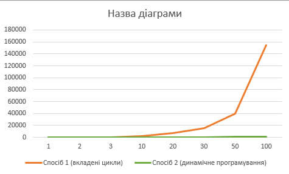\

---
###### Результати тестів:

Перший розв'язок:

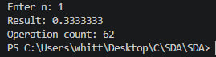\
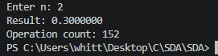\
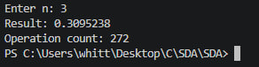\
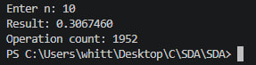\
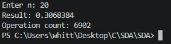\
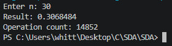\
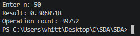\
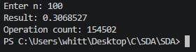


Другий розв'язок:

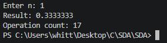\
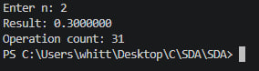\
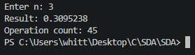\
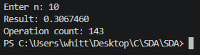\
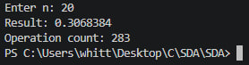\
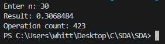\
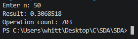\
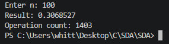

---